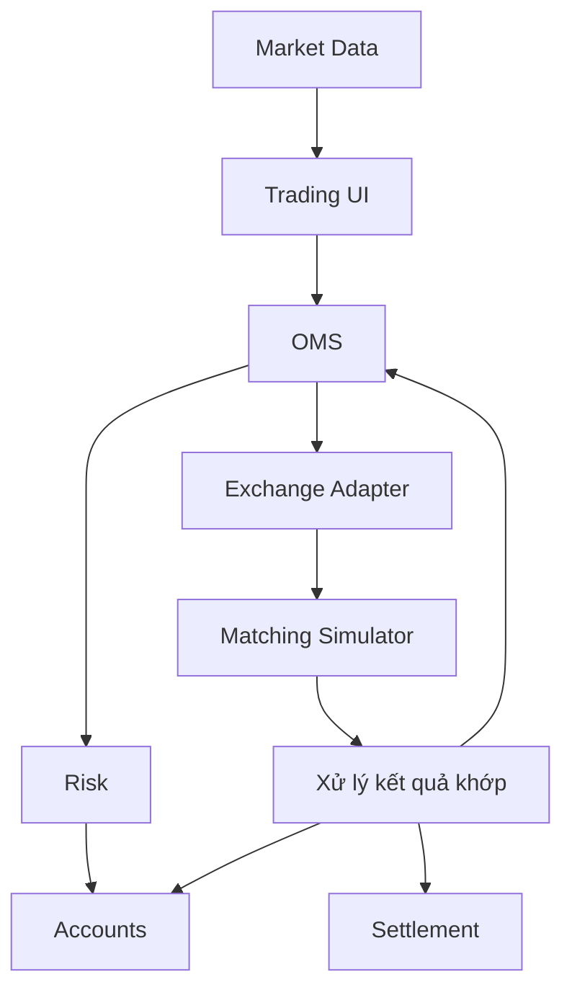
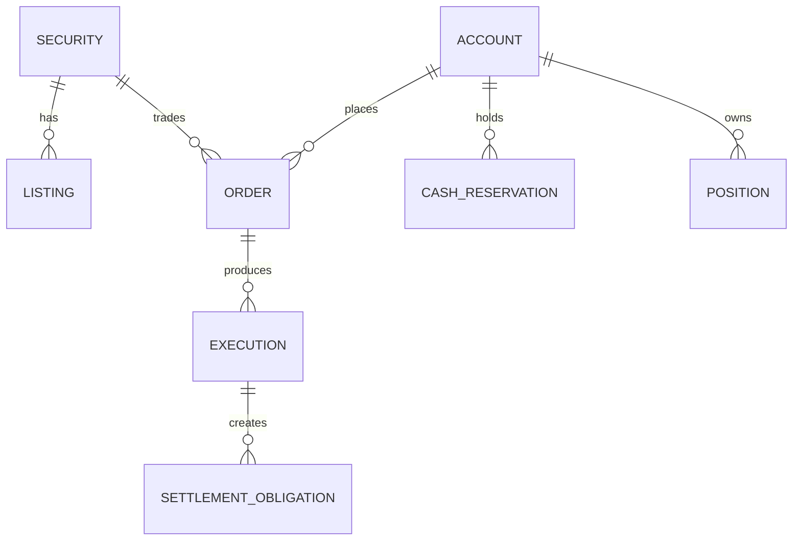

# Kiến trúc và quy ước

## 1. Phạm vi mô phỏng

Simulator tập trung vào giao dịch thứ cấp: nhà đầu tư mua hoặc bán chứng khoán đã phát hành. Dự án không triển khai IPO, không kết nối với sở giao dịch hoặc VSDC thật.

Trong mô hình học tập, ứng dụng chứa cả phần công ty chứng khoán và matching engine để có thể thực hành luồng end-to-end. Ngoài thực tế, hệ thống giao dịch của công ty chứng khoán và hệ thống khớp lệnh thị trường là các trách nhiệm tách biệt.

Các thành phần nghiệp vụ chính:

| Thành phần | Vai trò trong mô phỏng |
| --- | --- |
| Nhà đầu tư | Người dùng Trading UI |
| Công ty chứng khoán | Accounts, OMS, Risk, Portfolio và Exchange Adapter |
| Sở giao dịch | Được thay bằng Matching Simulator |
| Lưu ký/bù trừ/thanh toán | Được mô phỏng một phần bằng Settlement |
| Tổ chức phát hành | Dữ liệu thuộc Security Master |

## 2. Kiến trúc khởi đầu: modular monolith

Khởi đầu bằng frontend Vue 3 + TypeScript + Tailwind CSS, một backend Node.js/TypeScript, một database MySQL và các module phân chia theo nghiệp vụ. Module giao tiếp qua service interface; chưa cần tách microservice, triển khai Kubernetes hay đưa message broker vào luồng cốt lõi.

Sơ đồ mô tả trách nhiệm logic. Những cập nhật có liên quan đến lệnh và tài sản phải được phối hợp bằng transaction; không được coi mỗi mũi tên là một cập nhật độc lập.

### Module

| Module | Trách nhiệm chính |
| --- | --- |
| `System` | Health check, metadata và cấu hình hệ thống |
| `SecurityMaster` | Chứng khoán, niêm yết, quy tắc giao dịch có hiệu lực |
| `MarketData` | Snapshot/delta giá, sequence và phân phối realtime |
| `MarketSession` | Lịch và trạng thái phiên giao dịch |
| `MatchingSimulator` | Sổ lệnh, ưu tiên giá-thời gian, lần khớp |
| `Accounts` | Tiền, chứng khoán, khoản giữ và sổ cái |
| `OMS` | Tiếp nhận lệnh, vòng đời lệnh và idempotency |
| `Risk` | Điều kiện giao dịch, sức mua và quy tắc tài sản |
| `Portfolio` | Vị thế, giá vốn và lãi/lỗ |
| `Settlement` | Nghĩa vụ, thanh toán và đối soát |

## 3. Hai luồng dữ liệu cần phân biệt

### Luồng lệnh

1. Người dùng tạo yêu cầu mua/bán.
2. OMS xác thực yêu cầu và phối hợp Risk/Accounts để kiểm tra, giữ tài sản.
3. Lệnh được gửi vào Matching Simulator.
4. Kết quả khớp cập nhật lệnh, tiền/chứng khoán và tạo nghĩa vụ thanh toán.
5. Các tác vụ hậu xử lý nhận sự kiện qua outbox.

### Luồng giá

Market Data tạo hoặc nhận dữ liệu giá, lưu snapshot mới nhất và phát delta qua WebSocket. Giá trên bảng giá chỉ phục vụ thông tin thị trường; nó không chứng minh một lệnh cụ thể đã khớp.

## 4. Quy ước dữ liệu

| Dữ liệu | Quy ước | Ví dụ |
| --- | --- | --- |
| Giá | Số nguyên VND/cổ phiếu | `25000` |
| Tiền VND | Số nguyên đồng trong phạm vi bài học | `2500000` |
| Khối lượng | Số nguyên | `100` |
| Thời điểm API | ISO 8601 có múi giờ, lưu/truyền UTC | `2026-10-20T07:00:00Z` |
| Hiển thị thời gian | Chuyển sang `Asia/Ho_Chi_Minh` | `14:00` |
| ID | Định danh nội bộ ổn định | `sec-001` |
| Symbol | Trường hiển thị, không là khóa bất biến | `AAA` |

Không dùng số thực nhị phân cho tiền. Khi giá trị có thể vượt giới hạn an toàn của JavaScript `number`, cần chọn kiểu dữ liệu MySQL, kiểu TypeScript và cách tuần tự hóa JSON phù hợp.

Các cấu hình phiên, bước giá, biên độ và lịch thanh toán phải có ngày hiệu lực; không hard-code quy định vào logic giao dịch.

## 5. Mô hình dữ liệu khái niệm

- `order` là yêu cầu mua/bán; một lệnh có thể chưa khớp, khớp một phần hoặc khớp qua nhiều `execution`.
- `execution` là lần khớp cụ thể, không thay thế trạng thái tổng hợp của lệnh.
- Khoản giữ tiền/chứng khoán phải tách khỏi số dư hay vị thế tổng.
- Sổ cái và lịch sử biến động là nguồn để giải thích số dư; log văn bản không thay thế sổ cái.

## 6. Bất biến nghiệp vụ trọng yếu

1. Không chuyển lệnh từ trạng thái kết thúc sang trạng thái không hợp lệ.
2. Tổng khối lượng các lần khớp không vượt số lượng lệnh.
3. Một khoản tiền hoặc chứng khoán không được giữ cho nhiều lệnh vượt quá phần khả dụng.
4. Hủy lệnh khớp một phần chỉ giải phóng phần chưa khớp.
5. Cùng idempotency key và cùng request phải trả về cùng kết quả nghiệp vụ; cùng khóa nhưng payload khác phải báo xung đột.
6. Xử lý lại sự kiện không được làm tăng/giảm tài sản lần hai.
7. Một transaction lỗi không để lại cập nhật nghiệp vụ dở dang.
8. Batch thanh toán chạy lại không thanh toán trùng.
9. Người dùng không được đọc hoặc giao dịch trên tài khoản không thuộc quyền của họ.
10. Delta realtime cũ không được ghi đè dữ liệu mới; khoảng trống sequence phải được phát hiện.

## 7. Nhất quán và khả năng phục hồi

- Dùng InnoDB và transaction cho các thao tác thay đổi lệnh, khoản giữ và sổ cái liên quan.
- Bảo vệ thao tác kiểm tra rồi giữ tài sản bằng row lock, cập nhật có điều kiện hoặc optimistic locking đã được kiểm thử dưới tải đồng thời.
- Lưu dữ liệu nghiệp vụ và `outbox_events` trong cùng transaction. Worker phát lại được sự kiện; consumer phải idempotent.
- Redis là cache/snapshot, không phải nguồn quyết định số dư cuối cùng.
- Mỗi request và sự kiện cần correlation information như `requestId`, `correlationId`, `orderId`, `executionId` và `eventId`.

## 8. Khi nào cân nhắc tách service

Chỉ cân nhắc tách module khi có lý do rõ ràng như nhịp mở rộng độc lập, yêu cầu cô lập lỗi, ownership team riêng hoặc tải xử lý khác biệt. Trước đó, modular monolith giúp transaction, debug và triển khai đơn giản hơn.
