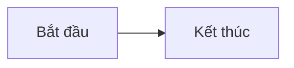

# Nghiệp vụ chứng khoán cho dev fullstack

Website tài liệu học nghiệp vụ chứng khoán dành cho developer fullstack, xây dựng bằng Vue 3, TypeScript và Vite. Lộ trình chính tập trung vào phân tích nghiệp vụ và hệ thống, không yêu cầu viết code.

> Đây là dự án mô phỏng phục vụ học tập, không dùng cho giao dịch chứng khoán thực tế.

## Yêu cầu

- [Node.js](https://nodejs.org/) phiên bản 20 trở lên
- npm (được cài kèm Node.js)
- Python 3.9 trở lên (chỉ cần cho bài kiểm tra OpenCode; dùng SQLite có sẵn trong thư viện chuẩn)

Kiểm tra phiên bản đã cài:

```bash
node --version
npm --version
```

## Cài đặt và chạy local

1. Clone dự án và đi vào thư mục dự án:

   ```bash
   git clone <repository-url>
   cd p-docs
   ```

2. Cài đặt dependencies:

   ```bash
   npm install
   ```

3. Khởi động development server:

   ```bash
   npm run dev
   ```

4. Mở địa chỉ Vite hiển thị trên terminal (thông thường là [http://localhost:5173](http://localhost:5173)).

Để cho phép thiết bị khác trong cùng mạng truy cập, chạy:

```bash
npm run dev -- --host
```

## Build và xem bản production

Tạo bản build:

```bash
npm run build
```

Kết quả được tạo trong thư mục `dist/`. Xem thử bản build trên máy local:

```bash
npm run preview
```

## Cập nhật tài liệu

- Trang mặc định là [`docs/README.md`](./docs/README.md); lộ trình chính là [`docs/lo-trinh-nghiep-vu-fullstack.md`](./docs/lo-trinh-nghiep-vu-fullstack.md).
- Các bài học chính không cần code nằm trực tiếp trong [`docs/`](./docs/), theo thứ tự đã khai báo trong [`src/App.vue`](./src/App.vue).
- Bộ tài liệu 28 ngày về xây simulator nằm trong [`archive/lo-trinh-28-ngay/`](./archive/lo-trinh-28-ngay/) và được hiển thị ở khu vực tham khảo.
- Có thể dùng sơ đồ Mermaid trong các code block `mermaid`.

Ví dụ tạo bài mới tại `docs/13-chu-de-moi.md`, rồi thêm đường dẫn vào `courseOrder` và điều chỉnh nhóm tương ứng để nó xuất hiện trong luồng học chính:

````md
# Buổi 13 — Tiêu đề bài học

Nội dung bài học.


````

## Kiểm tra tự luận với OpenCode — bản thử buổi 1

Mở OpenCode tại thư mục `p-docs`, sau đó dùng các custom command trong phiên tương tác:

| Lệnh | Mục đích |
| --- | --- |
| `/practice 01` | Tạo lượt mới, hỏi từng câu; xác nhận trước khi nộp. |
| `/practice-resume ID` | Tiếp tục lượt chưa nộp sau khi gián đoạn. |
| `/practice-grade ID` | Chấm bài đã nộp theo rubric và lưu kết quả. |
| `/practice-result ID` | Xem kết quả và lịch sử chấm. |

Thay `ID` bằng mã số OpenCode hiển thị khi bắt đầu. Bài thi gồm câu hỏi, đáp án tham khảo và tiêu chí chấm có phiên bản; đáp án không hiển thị trong lúc làm bài. Mỗi tiêu chí chấm 0–2; chỉ khi tất cả đạt 2 mới ghi nhận đạt. AI hỗ trợ đánh giá có thể sai; bạn có thể yêu cầu chấm lại, kết quả cũ vẫn được giữ. Muốn làm lại sau khi nộp, bắt đầu lượt mới.

Python lưu SQLite tại `~/.local/share/securities-learning/practice.sqlite3` hoặc `$XDG_DATA_HOME/securities-learning/practice.sqlite3` nếu biến môi trường này được đặt; đặt `SECURITIES_PRACTICE_DB` để chọn đường dẫn khác. Dữ liệu chứa câu trả lời và nhận xét cá nhân, không nằm trong repo; sao lưu file SQLite nếu cần. Khi gọi chấm, bài làm và rubric được gửi tới model OpenCode đang sử dụng theo cấu hình provider của bạn.

Lưu ý: đây là quy trình tương tác do AI thực hiện, không phải giao diện chấm độc lập; cần cho phép OpenCode chạy CLI và kiểm tra thông báo lỗi nếu thao tác lưu không thành công. Không ghi nhận hoàn thành chỉ vì đã trả lời đủ câu.

### Làm bài luyện tập trên website

Chạy API cục bộ trong một terminal tại `p-docs`:

```bash
python3 practice/server.py
```

Trong terminal khác chạy `npm run dev` (hoặc `npm run build` rồi `npm run preview`), mở website bằng địa chỉ `http://localhost:5173` hoặc địa chỉ localhost do Vite hiển thị, và chọn **Bài luyện tập**. API nghe trên `127.0.0.1:8765`; Vite chuyển tiếp yêu cầu chỉ từ máy cục bộ. Cần chạy cả API lẫn Vite và dùng cùng biến `SECURITIES_PRACTICE_DB`/`XDG_DATA_HOME` với OpenCode nếu đã tùy chỉnh đường dẫn SQLite.

Trên website, bắt đầu lượt buổi 01, trả lời lần lượt, lưu hoặc sửa câu trả lời, rồi xác nhận nộp bài. Sau khi nộp không thể chỉnh sửa. Sao chép lệnh `/practice-grade ID` trên web và chạy trong phiên OpenCode tại `p-docs`; làm mới trang để xem kết quả. Có thể tiếp tục bài đang làm bằng web hoặc `/practice-resume ID` trong OpenCode. Đáp án tham khảo, rubric và các câu chưa mở không được gửi tới trình duyệt khi làm bài.

Không dùng `--host` để chia sẻ trang luyện tập qua mạng; website tĩnh không kết nối được API này nếu không có máy chủ cục bộ. API có quyền ghi dữ liệu luyện tập, vì vậy chỉ chạy trên máy tin cậy và không công khai cổng API.

## Scripts

| Lệnh | Mô tả |
| --- | --- |
| `npm run dev` | Chạy development server với hot reload. |
| `npm run build` | Kiểm tra kiểu TypeScript và tạo bản build production. |
| `npm run preview` | Chạy local server để xem bản build trong `dist/`. |
