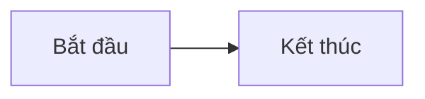

# Securities Trading Simulator Docs

Website tài liệu học tập cho dự án **Securities Trading Simulator**, được xây dựng với Vue 3, TypeScript và Vite.

> Đây là dự án mô phỏng phục vụ học tập, không dùng cho giao dịch chứng khoán thực tế.

## Yêu cầu

- [Node.js](https://nodejs.org/) phiên bản 20 trở lên
- npm (được cài kèm Node.js)

Kiểm tra phiên bản đã cài:

```bash
node --version
npm --version
```

## Cài đặt và chạy local

1. Clone dự án và đi vào thư mục dự án:

   ```bash
   git clone <repository-url>
   cd p-docs
   ```

2. Cài đặt dependencies:

   ```bash
   npm install
   ```

3. Khởi động development server:

   ```bash
   npm run dev
   ```

4. Mở địa chỉ Vite hiển thị trên terminal (thông thường là [http://localhost:5173](http://localhost:5173)).

Để cho phép thiết bị khác trong cùng mạng truy cập, chạy:

```bash
npm run dev -- --host
```

## Build và xem bản production

Tạo bản build:

```bash
npm run build
```

Kết quả được tạo trong thư mục `dist/`. Xem thử bản build trên máy local:

```bash
npm run preview
```

## Cập nhật tài liệu

- Các bài viết Markdown nằm trong thư mục [`docs/`](./docs/).
- Mỗi tệp `.md` trong thư mục này sẽ tự động xuất hiện trong danh mục website.
- [`docs/README.md`](./docs/README.md) là trang mặc định.
- Có thể dùng sơ đồ Mermaid trong các code block `mermaid`.

Ví dụ tạo bài mới tại `docs/ngay-02.md`:

````md
# Ngày 2 — Tiêu đề bài học

Nội dung bài học.


````

## Scripts

| Lệnh | Mô tả |
| --- | --- |
| `npm run dev` | Chạy development server với hot reload. |
| `npm run build` | Kiểm tra kiểu TypeScript và tạo bản build production. |
| `npm run preview` | Chạy local server để xem bản build trong `dist/`. |
