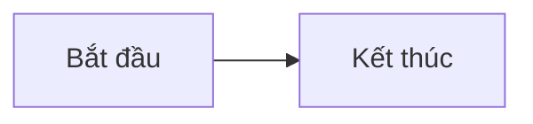

# Nghiệp vụ chứng khoán cho dev fullstack

Website tài liệu học nghiệp vụ chứng khoán dành cho developer fullstack, xây dựng bằng Vue 3, TypeScript và Vite. Lộ trình chính tập trung vào phân tích nghiệp vụ và hệ thống, không yêu cầu viết code.

> Đây là dự án mô phỏng phục vụ học tập, không dùng cho giao dịch chứng khoán thực tế.

## Yêu cầu

- [Node.js](https://nodejs.org/) phiên bản 20 trở lên
- npm (được cài kèm Node.js)

Kiểm tra phiên bản đã cài:

```bash
node --version
npm --version
```

## Cài đặt và chạy local

1. Clone dự án và đi vào thư mục dự án:

   ```bash
   git clone <repository-url>
   cd p-docs
   ```

2. Cài đặt dependencies:

   ```bash
   npm install
   ```

3. Khởi động development server:

   ```bash
   npm run dev
   ```

4. Mở địa chỉ Vite hiển thị trên terminal (thông thường là [http://localhost:5173](http://localhost:5173)).

Để cho phép thiết bị khác trong cùng mạng truy cập, chạy:

```bash
npm run dev -- --host
```

## Build và xem bản production

Tạo bản build:

```bash
npm run build
```

Kết quả được tạo trong thư mục `dist/`. Xem thử bản build trên máy local:

```bash
npm run preview
```

## Cập nhật tài liệu

- Trang mặc định là [`docs/README.md`](./docs/README.md); lộ trình chính là [`docs/lo-trinh-nghiep-vu-fullstack.md`](./docs/lo-trinh-nghiep-vu-fullstack.md).
- Các bài học chính không cần code nằm trực tiếp trong [`docs/`](./docs/), theo thứ tự đã khai báo trong [`src/App.vue`](./src/App.vue).
- Bộ tài liệu 28 ngày về xây simulator nằm trong [`archive/lo-trinh-28-ngay/`](./archive/lo-trinh-28-ngay/) và được hiển thị ở khu vực tham khảo.
- Có thể dùng sơ đồ Mermaid trong các code block `mermaid`.

Ví dụ tạo bài mới tại `docs/13-chu-de-moi.md`, rồi thêm đường dẫn vào `courseOrder` và điều chỉnh nhóm tương ứng để nó xuất hiện trong luồng học chính:

````md
# Buổi 13 — Tiêu đề bài học

Nội dung bài học.


````

## Scripts

| Lệnh | Mô tả |
| --- | --- |
| `npm run dev` | Chạy development server với hot reload. |
| `npm run build` | Kiểm tra kiểu TypeScript và tạo bản build production. |
| `npm run preview` | Chạy local server để xem bản build trong `dist/`. |
