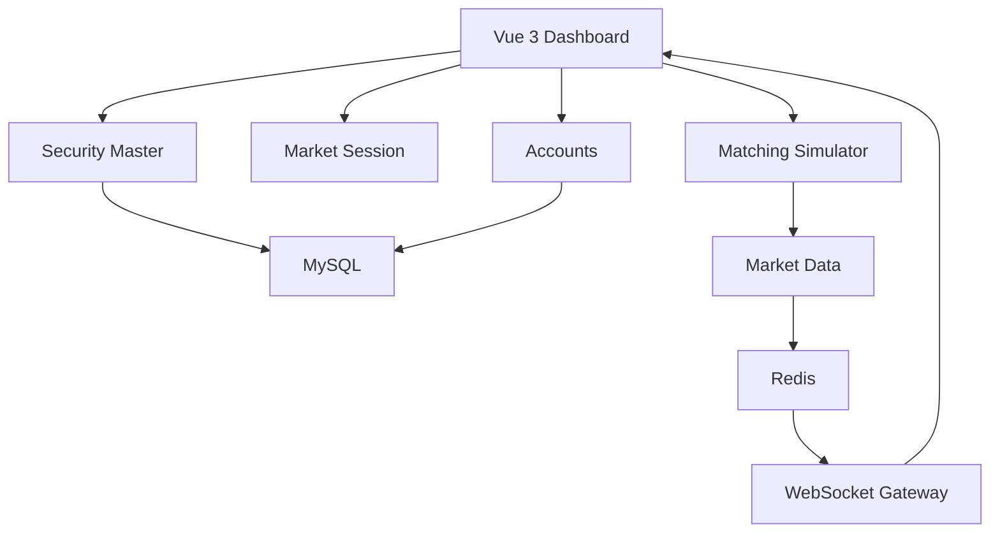

# Ngày 7 — Sản phẩm tuần 1: Bảng giá và giao dịch mô phỏng

Hôm nay bạn ghép các module của sáu ngày đầu thành **một bản demo có thể chạy và giải thích trong 5 phút**.

Mục tiêu là chứng minh dữ liệu đi đúng qua từng module: danh mục → phiên → sổ lệnh → lần khớp → bảng giá, đồng thời hiển thị tài sản và kiểm tra khả dụng.

Môi trường giữ nguyên: **Node.js + TypeScript, MySQL, Redis, Vue 3 + TypeScript + Tailwind CSS và OpenCode**.

---

## 1. Mục tiêu và phân bổ thời gian

| Thời gian | Nội dung | Kết quả |
|---|---|---|
| 30 phút nghiệp vụ | Ôn luồng giao dịch, xác định giới hạn demo | Giải thích được từng trạng thái |
| 30 phút kỹ thuật | Rà soát liên kết module và nguồn dữ liệu | Có luồng thống nhất |
| 30–60 phút thực hành | Ghép giao diện, chạy kịch bản, kiểm tra | Sản phẩm tuần 1 chạy được |

**Sản phẩm cuối buổi gồm:**

- Danh mục chứng khoán.
- Bảng giá realtime.
- Trạng thái phiên.
- Sổ lệnh mua/bán.
- Danh sách execution.
- Số dư tài khoản và kiểm tra khả dụng.

**Giới hạn tuần 1:** kết quả matching chưa cập nhật tiền hoặc chứng khoán của tài khoản. Phần tích hợp tài sản sẽ được triển khai trong tuần 2.

---

## 2. Nghiệp vụ — 30 phút

### 2.1. Ôn bằng một tình huống xuyên suốt

Tài khoản `acc-001` có:

```text
Tiền khả dụng:           6.000.000 đồng.
SIMAAA có thể bán:       550 cổ phiếu.
```

Bạn muốn mua:

```text
100 cổ phiếu SIMAAA.
LO giá 25.000 đồng.
```

Các module trả lời những câu hỏi khác nhau:

| Câu hỏi | Module |
|---|---|
| SIMAAA là chứng khoán nào? | Security Master |
| Chứng khoán có đang được giao dịch không? | Security Master |
| Hiện tại có được nhận LO không? | Market Session |
| Tài khoản có đủ tiền không? | Accounts |
| Lệnh gặp bên bán nào? | Matching Simulator |
| Có những lần khớp nào? | Matching Simulator |
| Bảng giá phải thay đổi ra sao? | Market Data |

Ở tuần 1, bạn có thể thực hiện từng bước bằng API. **Chưa có một transaction bao trùm đặt lệnh, giữ tài sản và xử lý khớp.**

### 2.2. Những khái niệm cần giải thích được

| Khái niệm | Câu trả lời cần nắm |
|---|---|
| Chứng khoán | Đối tượng được giao dịch, có định danh và thuộc tính |
| Phiên | Quy định cách tiếp nhận và xử lý giao dịch theo thời điểm |
| Lệnh | Yêu cầu mua hoặc bán |
| Execution | Một lần thực hiện giữa hai lệnh đối ứng |
| Sổ lệnh | Phần khối lượng chưa khớp đang chờ |
| Khả dụng | Phần tài sản được phép dùng theo chính sách |
| Snapshot | Trạng thái dữ liệu tại một thời điểm |

**Bài tự giải thích:**

> Một lệnh mua 100 cổ phiếu tạo hai execution thì tổng khối lượng thị trường tăng bao nhiêu?

Đáp án: cộng khối lượng của hai execution. Nếu khớp 40 và 60 thì tăng **100**, không phải 200.

### 2.3. Phân biệt dữ liệu đã làm với dữ liệu giả

| Thành phần | Trạng thái trong demo tuần 1 |
|---|---|
| Danh mục chứng khoán | Dữ liệu giả lưu trong MySQL |
| Lịch phiên | Cấu hình giả lập |
| Thời gian thị trường | `FixedClock` |
| Lệnh đối ứng | Tạo bằng script |
| Khớp LO liên tục | Thuật toán đã triển khai |
| Bảng giá | Sinh từ kết quả matching |
| Số dư tài khoản | Fixture MySQL, chưa thay đổi theo matching |
| Giữ tài sản khi đặt lệnh | Chưa tích hợp |
| Thanh toán | Chưa triển khai |

Trên giao diện, ghi rõ:

```text
Dữ liệu mô phỏng.
Số dư tài khoản chưa cập nhật theo matching.
```

---

## 3. Kỹ thuật — 30 phút

### 3.1. Rà soát kiến trúc hiện tại



Liên kết nghiệp vụ cần có:

- Matching Service kiểm tra chứng khoán qua Security Master.
- Matching Service kiểm tra phiên qua Market Session.
- Market Data nhận execution và trạng thái sổ từ Matching Simulator.
- Vue 3 ghép dữ liệu bằng `securityId`.

Không cần tạo thêm service triển khai độc lập.

### 3.2. Chốt một nguồn giá cho `sec-001`

Ngày 3 dùng bộ sinh tick. Ngày 5 có matching engine.

Trong bản demo tuần 1:

> **Matching Simulator là nguồn dữ liệu giao dịch duy nhất cho `sec-001`.**

Tắt bộ sinh giá ngẫu nhiên của chứng khoán này.

Nếu cả hai cùng chạy, bạn có thể gặp:

- Giá khớp trên bảng điện không có execution tương ứng.
- Tổng khối lượng tăng ngoài dự kiến.
- Dư mua/bán không khớp với sổ.
- Giá mở cửa, cao nhất, thấp nhất sai.

### 3.3. Khi nào cập nhật Market Data?

Có hai loại thay đổi:

| Thay đổi | Dữ liệu cần cập nhật |
|---|---|
| Thêm lệnh chưa khớp | Best bid/ask và khối lượng chờ |
| Phát sinh execution | Giá khớp, khối lượng, tổng giao dịch, OHLC và sổ |

Ví dụ:

```text
Sổ đang rỗng.
Thêm SELL 40 @24.900.

bestAsk = 24.900 × 40
lastPrice = null
totalVolume = 0
```

Không được lấy giá chào bán làm giá khớp gần nhất.

### 3.4. Thứ tự xử lý một yêu cầu

```text
Kiểm tra input và phiên
→ Matching engine xử lý xong
→ Lấy executions mới và sổ sau xử lý
→ Cập nhật Market Data
→ Lưu snapshot Redis
→ Publish cho WebSocket
```

Đối với snapshot bảng giá, dùng **sổ sau khi xử lý hoàn tất yêu cầu**.

Nếu một lệnh tạo hai execution:

- Cộng từng execution đúng một lần.
- `lastPrice` và `lastQuantity` lấy từ execution cuối.
- Best bid/ask lấy từ sổ hiện tại.

Chưa xây outbox hoặc khôi phục lỗi giữa các bước. Đây sẽ là nội dung tuần 3.

### 3.5. Khởi động một phiên demo sạch

Kịch bản phải bắt đầu từ trạng thái xác định:

```text
Sổ lệnh: rỗng.
Execution: rỗng.
lastPrice: null.
totalVolume: 0.
totalValue: 0.
open/high/low: null.
```

Nếu Redis còn snapshot của lần chạy trước, backend phải khởi tạo lại **đúng key của chứng khoán và ngày demo** khi bắt đầu phiên demo mới.

Không xóa toàn bộ Redis hoặc database để reset bài học.

Số dư MySQL được giữ nguyên; fixture đã có thì không chèn trùng.

---

## 4. Giao diện sản phẩm tuần 1

Không cần làm giao diện phức tạp. Một dashboard gồm các vùng sau là đủ:

| Vùng | Nội dung |
|---|---|
| Thông tin demo | Ngày phiên, Clock mode, cảnh báo mô phỏng |
| Trạng thái phiên | Phiên hiện tại, loại lệnh được nhận |
| Bảng giá | Mã, thị trường, tham chiếu, mua, khớp, bán, tổng KL |
| Sổ lệnh | Các mức giá và tổng khối lượng |
| Execution | Giá, khối lượng, thời điểm, hai lệnh liên quan |
| Tài khoản | Tiền và chứng khoán khả dụng |
| Kiểm tra thử | Nhập BUY/SELL, giá, khối lượng và xem kết quả |

**Quy tắc hiển thị:**

- Mã có kèm thị trường để phân biệt hai `SIMAAA`.
- Chưa có giá hiển thị `—`.
- API tài sản lỗi hiển thị lỗi, không thay bằng số 0.
- Tiền vẫn giữ dạng chuỗi chính xác từ API; không chuyển tùy tiện sang `number`.
- Giá cổ phiếu hiển thị rõ đơn vị đồng.
- Trạng thái kết nối và trạng thái phiên nằm riêng.
- Phân biệt nút **“Kiểm tra tài sản”** và thao tác **“Gửi lệnh simulator”**.

Không cần xây form gửi lệnh trên UI nếu script API đã đủ để demo.

---

## 5. Kịch bản demo chuẩn

Dùng thời gian cố định:

```dotenv
SIM_CLOCK_MODE=FIXED
SIM_NOW=2026-10-20T10:00:00+07:00
```

Đây là ngày phiên được chọn cho fixture; không bắt buộc trùng ngày hiện tại.

**Bước 1 — Kiểm tra danh mục và phiên**

Đọc:

```http
GET /api/securities/sec-001
GET /api/markets/SIM_EQ_A/session
```

Kỳ vọng:

```text
sec-001 thuộc SIM_EQ_A.
Chứng khoán TRADABLE.
Phiên CONTINUOUS.
LO được phép.
```

**Bước 2 — Kiểm tra tài khoản**

Đọc:

```http
GET /api/accounts/acc-001/balances
GET /api/accounts/acc-001/positions
```

Kỳ vọng:

```text
availableCash = 6.000.000 đồng.
availableQuantity của sec-001 = 550.
```

Kiểm tra thử mua 100 tại 25.000:

```text
Cần 2.500.000 đồng → hợp lệ.
```

Kiểm tra thử bán 600:

```text
Chỉ có thể bán 550 → từ chối, thiếu 50.
```

**Bước 3 — Đưa ba lệnh bán vào simulator**

| clientOrderId | Phía | Giá | Khối lượng |
|---|---|---:|---:|
| S1 | SELL | 24.900 | 40 |
| S2 | SELL | 25.000 | 100 |
| S3 | SELL | 25.100 | 50 |

Kỳ vọng:

```text
Chưa có execution.
bestAsk = 24.900 × 40.
lastPrice = null.
totalVolume = 0.
```

**Bước 4 — Gửi lệnh mua B1**

```json
{
  "clientOrderId": "B1",
  "securityId": "sec-001",
  "side": "BUY",
  "orderType": "LO",
  "price": 25000,
  "quantity": 100
}
```

Execution:

| Thứ tự | Giá | Khối lượng | Giá trị |
|---|---:|---:|---:|
| E1 | 24.900 | 40 | 996.000 |
| E2 | 25.000 | 60 | 1.500.000 |
| Tổng | | **100** | **2.496.000** |

**Bước 5 — Đối chiếu bảng giá và sổ**

Snapshot mong đợi:

```json
{
  "securityId": "sec-001",
  "referencePrice": 25000,
  "lastPrice": 25000,
  "lastQuantity": 60,
  "totalVolume": 100,
  "totalValue": 2496000,
  "openPrice": 24900,
  "highPrice": 25000,
  "lowPrice": 24900,
  "bestBid": null,
  "bestAsk": {
    "price": 25000,
    "quantity": 40
  }
}
```

Sổ còn:

| Phía | Giá | Khối lượng |
|---|---:|---:|
| SELL | 25.000 | 40 |
| SELL | 25.100 | 50 |

**Điểm dễ nhầm:** `lastQuantity` là 60, không phải 100. Còn `totalVolume` là 100.

Giá cuối bằng tham chiếu nên ô giá khớp dùng màu tham chiếu, dù trước đó đã có giao dịch tại 24.900.

**Bước 6 — Kiểm tra số dư**

Số dư tài khoản vẫn là fixture ban đầu:

```text
Tiền khả dụng: 6.000.000.
SIMAAA có thể bán: 550.
```

Đó là giới hạn hiện tại của demo. Chưa được diễn giải thành tài khoản đã thanh toán cho giao dịch B1.

---

## 6. API dùng trong bản demo

| Chức năng | API |
|---|---|
| Kiểm tra backend | `GET /health/live` |
| Kiểm tra database | `GET /health/ready` |
| Danh mục | `GET /api/securities` |
| Phiên | `GET /api/markets/SIM_EQ_A/session` |
| Snapshot giá | `GET /api/market-data/quotes?securityIds=sec-001` |
| Gửi lệnh giả lập | `POST /api/simulator/orders` |
| Sổ lệnh | `GET /api/simulator/order-books/sec-001` |
| Execution | `GET /api/simulator/executions?securityId=sec-001` |
| Tiền | `GET /api/accounts/acc-001/balances` |
| Chứng khoán | `GET /api/accounts/acc-001/positions` |
| Kiểm tra tài sản | `POST /api/accounts/acc-001/availability-checks` |

Giữ nguyên ý nghĩa readiness ngày 1 là kiểm tra database. Nếu dashboard cần kiểm tra Redis, bổ sung một check có tên rõ ràng thay vì mặc định database sẵn sàng đồng nghĩa mọi chức năng realtime đều hoạt động.

---

## 7. Thực hành — 30–60 phút

| Thời gian | Công việc |
|---|---|
| 10–15 phút | Nối matching với Market Data |
| 10–15 phút | Ghép dashboard từ component đã có |
| 10–15 phút | Viết script chạy kịch bản và đối chiếu |
| 10–15 phút mở rộng | Hoàn thiện README, xử lý lỗi hiển thị |

**Ưu tiên hoàn thành:**

1. Chỉ một nguồn giá cho `sec-001`.
2. Kịch bản cho đúng hai execution và đúng snapshot.
3. Dashboard hiển thị được các kết quả.
4. Có cách khởi động và demo lặp lại.

Nếu một phần của ngày trước chưa hoàn thành, ưu tiên hoàn thiện đường đi tối thiểu của kịch bản; không thêm biểu đồ hoặc trang trí trước.

---

## 8. Kiểm tra tích hợp quan trọng

Không cần viết lại toàn bộ kiểm thử từng module. Giữ các kiểm thử cũ và bổ sung một kịch bản tích hợp có giá trị:

```text
Sổ rỗng
→ S1, S2, S3
→ B1
→ 2 execution
→ Sổ còn 40 và 50
→ Snapshot tổng volume=100, value=2.496.000
```

Các điểm kiểm tra:

| Nội dung | Kỳ vọng |
|---|---|
| Tổng lượng execution | 100 |
| Tổng giá trị execution | 2.496.000 |
| Tổng lượng trên Market Data | 100 |
| Lần khớp cuối | 60 tại 25.000 |
| Dư bán tốt nhất | 40 tại 25.000 |
| Số dư tài khoản | Không đổi |
| `sec-005` cùng symbol | Không nhận nhầm giá |
| Mở tab thứ hai | Không sinh thêm lệnh hoặc execution |
| Reload giao diện | Không chạy lại seed scenario |

REST và WebSocket có thể đến UI ở thời điểm khác nhau. Khi đối chiếu, chờ sự kiện cập nhật hoặc dùng polling có timeout hữu hạn; không giả định ngay sau POST thì mọi panel đã render xong.

---

## 9. Tình huống debug

### A. Reload trang làm tổng khối lượng tăng thêm 100

Nguyên nhân thường gặp: component tự gọi script seed hoặc gửi B1 trong `onMounted`.

Cách sửa:

- Script tạo lệnh nằm ngoài luồng render.
- Component chỉ đọc và subscribe.
- Không phát sinh giao dịch chỉ vì mount hoặc reload trang.

### B. Snapshot REST đúng nhưng UI sai

Điều tra theo thứ tự:

1. Đọc response REST.
2. Xem bản tin WebSocket.
3. Kiểm tra map theo `securityId`.
4. Kiểm tra UI đang thay snapshot hay cộng tiếp dữ liệu.
5. Kiểm tra có REST response cũ ghi đè bản tin mới không.

### C. Sổ không có giá mua nhưng UI vẫn hiện giá mua cũ

Market Data đã gửi:

```json
{
  "bestBid": null
}
```

Frontend dùng cách merge bỏ qua giá trị `null`, làm mức mua cũ còn lại.

Với snapshot đầy đủ, `null` là dữ liệu có ý nghĩa: **hiện không có mức mua**. Phải thay thế trạng thái cũ.

### D. Backend vừa khởi động nhưng bảng giá có volume từ lần chạy trước

Engine trong bộ nhớ đã rỗng, Redis vẫn còn snapshot cũ.

Cách sửa: quy trình bắt đầu phiên demo phải khởi tạo đồng bộ sổ, execution và snapshot tương ứng. Chỉ reset dữ liệu mô phỏng thuộc phiên đang chạy.

---

## 10. README cần hoàn thiện

README nên giúp bạn hoặc người khác chạy demo mà không phải đọc lại cuộc trò chuyện:

| Phần | Nội dung |
|---|---|
| Mục tiêu | Simulator tuần 1 làm được gì |
| Môi trường | Phiên bản thực tế đang sử dụng |
| Cấu hình | MySQL, Redis, backend, frontend, Clock |
| Khởi tạo | Migration và seed |
| Chạy ứng dụng | Lệnh khởi động các thành phần |
| Chạy demo | Script và thứ tự thao tác |
| Kết quả kỳ vọng | Hai execution và snapshot chuẩn |
| Giới hạn | Sổ trong bộ nhớ, chưa tích hợp tài sản |
| Xử lý lỗi | Database/Redis chưa chạy, trùng fixture, snapshot cũ |

Không ghi mật khẩu thật vào README.

---

## 11. Prompt cho OpenCode

```text
Tôi đang học ngày 7 của Securities Trading Simulator:
Hoàn thiện sản phẩm tuần 1.

Môi trường:
- Node.js + TypeScript, MySQL, Redis, Vue 3 + TypeScript + Tailwind CSS.
- OpenCode, cấu hình model hiện tại.
- Modular monolith.
- Giữ code và API ngày 1–6.

Trước khi code:
1. Đọc các module hiện có.
2. Liệt kê phần đã hoạt động, phần còn thiếu.
3. Xác định nguồn giá hiện tại của sec-001.
4. Chọn phạm vi tối thiểu cho 30–60 phút.
5. Không mặc định các bài trước đã được triển khai đầy đủ.

Mục tiêu:
- Dashboard có danh mục, phiên, bảng giá, sổ lệnh,
  executions và tài sản tài khoản.
- Kịch bản demo lặp lại được từ môi trường vừa khởi động.
- Chưa tích hợp execution vào số dư hoặc giữ tài sản.

Tích hợp:
1. Matching là nguồn giao dịch duy nhất cho sec-001.
2. Tắt random generator của sec-001.
3. Sau mỗi submit:
   - Engine xử lý hoàn tất.
   - Lấy executions mới và sổ sau xử lý.
   - Cập nhật Market Data.
   - Lưu Redis rồi publish WebSocket.
4. Không có execution thì không tăng volume/value.
5. Mỗi execution chỉ cộng volume/value một lần.
6. Bid/ask phản ánh sổ mới kể cả khi chưa có giao dịch.
7. lastPrice/lastQuantity lấy từ execution cuối.
8. Snapshot đầy đủ có thể chứa null và UI phải áp dụng null.
9. Vue 3 ghép dữ liệu theo securityId, không theo symbol.

Khởi tạo demo:
- Clock FIXED: 2026-10-20T10:00:00+07:00.
- Sổ và executions rỗng.
- Quote volume/value=0, last/open/high/low=null.
- Reset đúng snapshot của mã và ngày demo khi bắt đầu phiên mới.
- Không xóa toàn bộ Redis hoặc MySQL.
- Seed MySQL không được chèn trùng hoặc xóa dữ liệu ngoài phạm vi.
- Nếu phát hiện engine không rỗng trước kịch bản, báo rõ;
  không âm thầm chạy chồng fixture.

Kịch bản:
1. Kiểm tra sec-001 TRADABLE, phiên CONTINUOUS.
2. Đọc acc-001:
   availableCash=6000000, sec-001 availableQuantity=550.
3. Preview BUY 100@25000 hợp lệ.
4. Preview SELL 600 bị từ chối, thiếu 50.
5. Gửi:
   S1 SELL 40@24900.
   S2 SELL 100@25000.
   S3 SELL 50@25100.
6. Gửi B1 BUY 100@25000.

Kỳ vọng:
- E1: 40@24900.
- E2: 60@25000.
- B1 FILLED.
- S2 còn 40, S3 còn 50.
- Quote:
  lastPrice=25000
  lastQuantity=60
  totalVolume=100
  totalValue=2496000
  openPrice=24900
  highPrice=25000
  lowPrice=24900
  bestBid=null
  bestAsk={price:25000,quantity:40}.
- Số dư tài khoản không thay đổi.

Frontend:
- Thể hiện rõ dữ liệu mô phỏng và số dư chưa nối matching.
- Tách trạng thái phiên và trạng thái kết nối.
- Không có dữ liệu hiển thị —.
- Lỗi số dư hiển thị lỗi, không thay bằng 0.
- Không phát lệnh hoặc seed scenario trong onMounted.
- Reload hoặc mở tab không tạo giao dịch.
- Chưa cần form đặt lệnh nếu script API đủ để demo.

Xác minh:
- Bổ sung một kiểm thử tích hợp cho kịch bản chuẩn.
- Chạy kiểm thử hồi quy hiện có phù hợp với thay đổi.
- Kiểm tra REST snapshot và dữ liệu UI hội tụ đúng kết quả.
- Không nhầm sec-001 với sec-005.
- Hai tab không tăng số executions.
- Dùng timeout hữu hạn khi chờ cập nhật, không sleep cố định dài.

Sau khi làm:
- Báo kết quả kiểm tra thực tế.
- Cập nhật README về cấu hình, migration, seed, chạy demo.
- Ghi rõ giới hạn: bộ nhớ mất khi restart,
  chưa giữ tài sản, chưa settlement, chưa outbox/replay.
- Chuẩn bị hướng dẫn demo 5 phút.
```

## Ngày 7 hoàn thành khi bạn có thể demo trong 5 phút:

1. Mở dashboard, giải thích chứng khoán và phiên.
2. Xem tiền, chứng khoán khả dụng.
3. Chạy kiểm tra tài sản hợp lệ và bị từ chối.
4. Đưa lệnh vào simulator.
5. Chỉ ra hai execution và phần dư trong sổ.
6. Đối chiếu bảng giá với execution.
7. Nêu rõ số dư chưa cập nhật theo matching.

Ngày 8 bắt đầu tuần 2 với **OMS và vòng đời lệnh**: lưu lệnh, ghi lịch sử sự kiện và kiểm soát các chuyển trạng thái hợp lệ.
