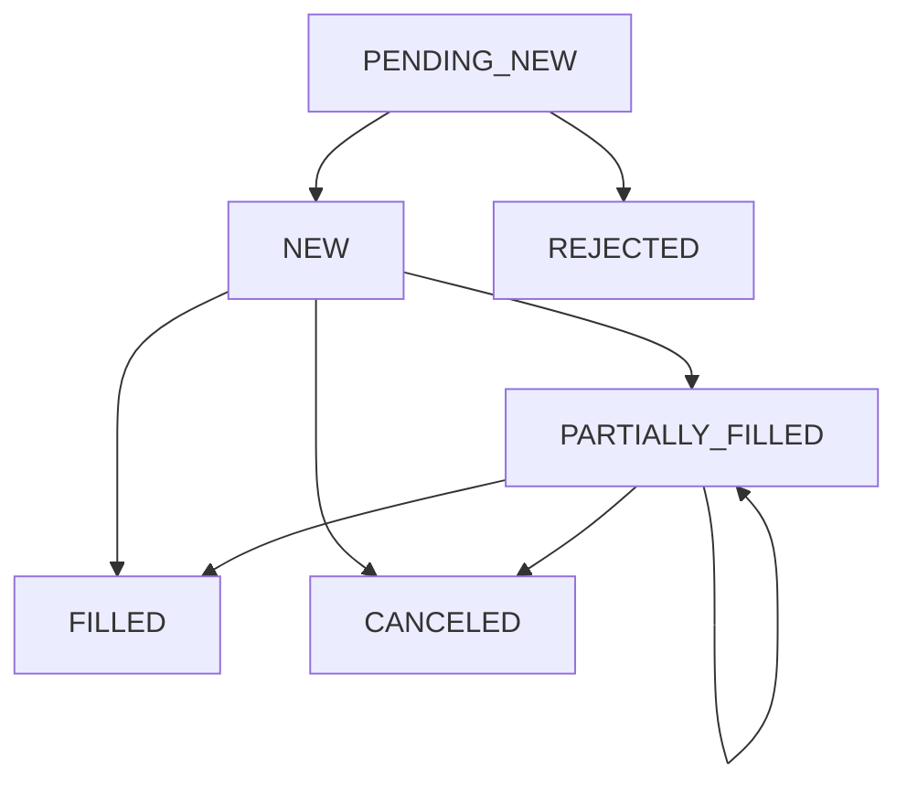

# Ngày 8 — OMS và vòng đời lệnh

Tuần 1 đã có sổ lệnh, matching và bảng giá. Hôm nay bạn bắt đầu xây **Order Management System — OMS** để lưu và giải thích hành trình của từng lệnh:

> “Lệnh đã được tiếp nhận chưa, đã khớp bao nhiêu, còn bao nhiêu và yêu cầu hủy đang ở bước nào?”

Môi trường giữ nguyên: **Node.js + TypeScript, MySQL, Vue 3 + TypeScript + Tailwind CSS và OpenCode**.

---

## 1. Mục tiêu và phân bổ thời gian

| Thời gian | Nội dung | Kết quả |
|---|---|---|
| 30 phút nghiệp vụ | Trạng thái lệnh và yêu cầu hủy | Phân biệt nhận, khớp, hủy và từ chối |
| 30 phút kỹ thuật | State machine, bảng lệnh và sự kiện | Có quy tắc chuyển trạng thái |
| 30–60 phút thực hành | Lưu MySQL, chạy kịch bản, đọc timeline | Dựng lại được lịch sử một lệnh |

**Sản phẩm cuối buổi:** một lệnh được lưu trong MySQL, cập nhật qua các sự kiện hợp lệ và có timeline giải thích được từng thay đổi.

Hôm nay chưa tích hợp giữ tiền hoặc thanh toán. Matching ngày 5 vẫn là module riêng; trước tiên dùng các phản hồi mô phỏng để kiểm tra OMS.

---

## 2. Nghiệp vụ — 30 phút

### 2.1. OMS khác matching engine thế nào?

| Thành phần | Câu hỏi chính |
|---|---|
| OMS | Lệnh của khách hàng đang ở đâu và đã xảy ra chuyện gì? |
| Matching engine | Lệnh nào gặp lệnh nào, khớp giá và khối lượng bao nhiêu? |
| Accounts | Tài sản nào đang có, được giữ hoặc đã được sử dụng? |
| Market Data | Thị trường và bảng giá đang hiển thị trạng thái gì? |

Một lệnh có thể đã được OMS lưu nhưng chưa được thị trường chấp nhận. Vì vậy, không đặt trạng thái `NEW` ngay chỉ vì `INSERT orders` thành công.

### 2.2. Sáu trạng thái dùng trong bài

| Trạng thái | Ý nghĩa trong simulator |
|---|---|
| `PENDING_NEW` | Đã ghi nhận yêu cầu, chờ phản hồi tiếp nhận |
| `NEW` | Đã được chấp nhận, chưa khớp |
| `PARTIALLY_FILLED` | Đã khớp một phần, vẫn còn phần hoạt động |
| `FILLED` | Khớp toàn bộ |
| `CANCELED` | Phần chưa khớp đã được xác nhận hủy |
| `REJECTED` | Yêu cầu tạo lệnh bị từ chối |

Các khái niệm này tương ứng với những trạng thái thường gặp trong hệ thống giao dịch. Đặc tả FIX phân biệt lệnh mới, khớp một phần, khớp hết, hủy và từ chối; đồng thời có các tình huống lệnh tiếp tục khớp khi yêu cầu hủy đang chờ xử lý. [FIX Trading Community](https://archive.fixtrading.org/online-specification/business-area-trade/?utm_source=chatgpt.com)

Mô hình hôm nay là tập con phục vụ học tập, chưa triển khai đầy đủ FIX, sửa lệnh, hết hiệu lực hoặc điều chỉnh giao dịch.

### 2.3. Đã hủy không có nghĩa chưa từng khớp

Ví dụ:

```text
Đặt mua 100.
Khớp 40.
Hủy thành công phần còn lại 60.
```

Kết quả:

```text
status            = CANCELED
quantity          = 100
filledQuantity    = 40
canceledQuantity  = 60
remainingQuantity = 0
```

Không đặt `filledQuantity = 0` khi hủy.

Lịch sử đã khớp vẫn còn và sau này vẫn tạo nghĩa vụ tài sản, thanh toán.

### 2.4. Gửi yêu cầu hủy chưa phải hủy thành công

Tình huống:

```text
10:00:00 — Lệnh mua 100 được chấp nhận.
10:00:01 — Khớp 40.
10:00:02 — Người dùng gửi yêu cầu hủy.
10:00:03 — Khớp thêm 20.
10:00:04 — Xác nhận hủy 40 còn lại.
```

Kết quả cuối:

```text
Khớp: 60.
Hủy: 40.
```

Nếu frontend hiển thị “Đã hủy 60” ngay khi nhấn nút, thông tin đó có thể sai.

### 2.5. Tách trạng thái lệnh khỏi trạng thái yêu cầu hủy

Trong simulator, dùng hai trường:

```ts
type OrderStatus =
  | "PENDING_NEW"
  | "NEW"
  | "PARTIALLY_FILLED"
  | "FILLED"
  | "CANCELED"
  | "REJECTED";

type CancelRequestStatus =
  | "NONE"
  | "PENDING"
  | "ACCEPTED"
  | "REJECTED";
```

Ví dụ khi đang chờ hủy:

```json
{
  "status": "PARTIALLY_FILLED",
  "cancelRequestStatus": "PENDING",
  "filledQuantity": 40,
  "remainingQuantity": 60
}
```

Không cần đổi trạng thái chính thành `CANCELED` để thể hiện người dùng vừa gửi yêu cầu.

Đây là mô hình nội bộ của bài học, không phải ánh xạ nguyên trạng mọi trường trạng thái của FIX.

---

## 3. State machine — những chuyển trạng thái được phép

### 3.1. Vòng đời chính



`CancelRequested` không xuất hiện thành một nút ở sơ đồ chính vì nó cập nhật trạng thái yêu cầu hủy riêng.

### 3.2. Bảng xử lý sự kiện

| Trạng thái hiện tại | Sự kiện | Kết quả |
|---|---|---|
| Chưa có lệnh | `OrderReceived` | Tạo `PENDING_NEW` |
| `PENDING_NEW` | `OrderAccepted` | `NEW` |
| `PENDING_NEW` | `OrderRejected` | `REJECTED` |
| `NEW` / `PARTIALLY_FILLED` | `ExecutionReceived` | Tăng lượng khớp; thành partial hoặc filled |
| `NEW` / `PARTIALLY_FILLED` | `CancelRequested` | Giữ trạng thái chính, hủy chuyển `PENDING` |
| `NEW` / `PARTIALLY_FILLED`, đang chờ hủy | `CancelConfirmed` | `CANCELED`, hủy phần còn lại |
| Đang chờ hủy | `CancelRejected` | Hủy chuyển `REJECTED`, trạng thái chính giữ nguyên |
| `FILLED` | `CancelConfirmed` | Từ chối trong mô hình hôm nay |

Phạm vi ngày 8 yêu cầu phản hồi tiếp nhận đến trước execution. Chưa xử lý bản tin đến sai thứ tự, trade correction hoặc phản hồi muộn sau xác nhận hủy.

### 3.3. Các chuyển đổi phải chặn

```text
FILLED → CANCELED
CANCELED → NEW
REJECTED → PARTIALLY_FILLED
PENDING_NEW → FILLED bằng thao tác sửa status trực tiếp
```

Không cung cấp hàm kiểu:

```ts
updateOrderStatus(orderId, arbitraryStatus);
```

Thay vào đó:

```ts
applyOrderEvent(order, event);
```

Hàm tự tính trạng thái mới từ sự kiện và dữ liệu hiện tại.

---

## 4. Khối lượng và các bất biến

Ví dụ một lệnh đã được chấp nhận:

```text
quantity
= filledQuantity
+ remainingQuantity
+ canceledQuantity
```

| Trạng thái | Đặc điểm |
|---|---|
| `PENDING_NEW` | Chưa khớp; remaining bằng quantity, nhưng chưa nằm trong sổ thị trường |
| `NEW` | Filled bằng 0, remaining bằng quantity |
| `PARTIALLY_FILLED` | Filled > 0 và remaining > 0 |
| `FILLED` | Filled bằng quantity, remaining và canceled bằng 0 |
| `CANCELED` | Remaining bằng 0, canceled là phần đã hủy |
| `REJECTED` | Filled, remaining và canceled đều bằng 0 |

Với `REJECTED`, `quantity` vẫn giữ khối lượng đã yêu cầu để phục vụ lịch sử; không áp dụng công thức bảo toàn của lệnh được chấp nhận.

**Khi nhận execution:**

```text
0 < execution.quantity <= remainingQuantity
```

Cập nhật:

```text
filledQuantity += execution.quantity
remainingQuantity -= execution.quantity
```

Không cộng `cumulativeFilledQuantity` như thể đó là khối lượng phát sinh mới.

**Khi xác nhận hủy:**

```text
canceledQuantity = remainingQuantity tại thời điểm xác nhận
remainingQuantity = 0
status = CANCELED
cancelRequestStatus = ACCEPTED
```

Không lấy lượng còn lại tại thời điểm người dùng bấm hủy để ghi đè kết quả sau đó.

---

## 5. Thiết kế MySQL

Hai bảng:

| Bảng | Vai trò |
|---|---|
| `orders` | Trạng thái hiện tại, phục vụ truy vấn nhanh |
| `order_events` | Lịch sử có thứ tự của từng lệnh |

### 5.1. Bảng lệnh

```sql
CREATE TABLE orders (
    id VARCHAR(36) NOT NULL,
    account_id VARCHAR(36) NOT NULL,
    security_id VARCHAR(36) NOT NULL,

    side ENUM('BUY', 'SELL') NOT NULL,
    order_type ENUM('LO') NOT NULL,
    price DECIMAL(20,0) NOT NULL,
    quantity INT UNSIGNED NOT NULL,

    filled_quantity INT UNSIGNED NOT NULL DEFAULT 0,
    remaining_quantity INT UNSIGNED NOT NULL,
    canceled_quantity INT UNSIGNED NOT NULL DEFAULT 0,

    status ENUM(
        'PENDING_NEW',
        'NEW',
        'PARTIALLY_FILLED',
        'FILLED',
        'CANCELED',
        'REJECTED'
    ) NOT NULL,

    cancel_request_status ENUM(
        'NONE',
        'PENDING',
        'ACCEPTED',
        'REJECTED'
    ) NOT NULL DEFAULT 'NONE',

    version INT UNSIGNED NOT NULL DEFAULT 1,

    created_at TIMESTAMP(3) NOT NULL
        DEFAULT CURRENT_TIMESTAMP(3),

    updated_at TIMESTAMP(3) NOT NULL
        DEFAULT CURRENT_TIMESTAMP(3)
        ON UPDATE CURRENT_TIMESTAMP(3),

    PRIMARY KEY (id),

    FOREIGN KEY (account_id) REFERENCES accounts(id),
    FOREIGN KEY (security_id) REFERENCES securities(id),

    CONSTRAINT chk_order_input CHECK (
        price > 0 AND quantity > 0
    ),

    CONSTRAINT chk_order_quantities CHECK (
        filled_quantity + remaining_quantity + canceled_quantity
        <= quantity
    ),

    INDEX idx_orders_account_created (
        account_id,
        created_at
    )
) ENGINE=InnoDB DEFAULT CHARSET=utf8mb4;
```

Ràng buộc SQL trên là lớp bảo vệ cơ bản. Service phải kiểm tra các bất biến mạnh hơn theo từng trạng thái.

`version` vừa hỗ trợ thứ tự cập nhật, vừa chuẩn bị cho kiểm soát đồng thời ở các bài sau.

### 5.2. Bảng lịch sử

```sql
CREATE TABLE order_events (
    id VARCHAR(36) NOT NULL,
    order_id VARCHAR(36) NOT NULL,
    event_sequence INT UNSIGNED NOT NULL,

    event_type VARCHAR(64) NOT NULL,
    from_status VARCHAR(32) NULL,
    to_status VARCHAR(32) NOT NULL,

    reason_code VARCHAR(64) NULL,
    payload JSON NOT NULL,

    occurred_at TIMESTAMP(3) NOT NULL,
    recorded_at TIMESTAMP(3) NOT NULL
        DEFAULT CURRENT_TIMESTAMP(3),

    PRIMARY KEY (id),

    FOREIGN KEY (order_id) REFERENCES orders(id),

    UNIQUE KEY uq_order_event_sequence (
        order_id,
        event_sequence
    )
) ENGINE=InnoDB DEFAULT CHARSET=utf8mb4;
```

Phân biệt:

- `occurred_at`: thời điểm nghiệp vụ theo Clock hoặc nguồn sự kiện.
- `recorded_at`: thời điểm database ghi nhận.
- `event_sequence`: thứ tự xử lý của một lệnh.

Với `FixedClock`, nhiều sự kiện có thể cùng timestamp. Timeline vẫn phải sắp xếp theo `event_sequence`.

### 5.3. Ghi trạng thái và sự kiện cùng transaction

```text
BEGIN
→ Đọc và khóa hàng orders cần cập nhật
→ Kiểm tra sự kiện có hợp lệ
→ Tính trạng thái và khối lượng mới
→ UPDATE orders, tăng version
→ INSERT order_events, sequence bằng version mới
COMMIT
```

Nếu ghi sự kiện thất bại, trạng thái lệnh cũng phải rollback.

Hôm nay có thể dùng khóa hàng đơn giản để tránh ghi đè khi cùng cập nhật một lệnh. Ngày 19 sẽ đào sâu chiến lược concurrency.

**Không dùng transaction MySQL để giả định đã bao phủ cả matching trong bộ nhớ.** Hai phần chưa được tích hợp nguyên tử ở ngày 8.

---

## 6. Nội dung sự kiện phải đủ để giải thích lịch sử

Ví dụ:

```json
{
  "eventType": "ExecutionReceived",
  "payload": {
    "executionId": "demo-exe-001",
    "quantity": 40,
    "price": "24900"
  }
}
```

Sự kiện tạo lệnh cần có các thuộc tính gốc:

```json
{
  "eventType": "OrderReceived",
  "payload": {
    "accountId": "acc-001",
    "securityId": "sec-001",
    "side": "BUY",
    "orderType": "LO",
    "price": "25000",
    "quantity": 100
  }
}
```

Sự kiện từ chối cần lý do:

```json
{
  "eventType": "OrderRejected",
  "reasonCode": "SIMULATED_REJECTION",
  "payload": {
    "message": "Phản hồi từ chối dùng trong bài thực hành."
  }
}
```

Có thể dùng một reducer để áp dụng lại các sự kiện theo sequence và đối chiếu với hàng `orders`.

Đây là **lịch sử nghiệp vụ có thể kiểm chứng**, chưa cần chuyển toàn bộ hệ thống sang kiến trúc event sourcing.

---

## 7. API cho bài thực hành

Để tránh nhầm với API giao dịch hoàn chỉnh ở ngày 9, dùng namespace:

```text
/api/oms-demo
```

| API | Mục đích |
|---|---|
| `POST /api/oms-demo/orders` | Tạo lệnh `PENDING_NEW` |
| `GET /api/oms-demo/orders/:id` | Đọc trạng thái hiện tại |
| `GET /api/oms-demo/orders/:id/events` | Đọc timeline |
| `POST /api/oms-demo/orders/:id/simulate` | Cấp phản hồi mô phỏng cho bài học |

**Tạo lệnh:**

```json
{
  "accountId": "acc-001",
  "securityId": "sec-001",
  "side": "BUY",
  "orderType": "LO",
  "price": 25000,
  "quantity": 100
}
```

**Mô phỏng phản hồi chấp nhận:**

```json
{
  "type": "OrderAccepted"
}
```

**Mô phỏng khớp:**

```json
{
  "type": "ExecutionReceived",
  "executionId": "demo-exe-001",
  "quantity": 40,
  "price": 24900
}
```

**Mô phỏng yêu cầu hủy:**

```json
{
  "type": "CancelRequested"
}
```

Endpoint `simulate` chỉ nhận các sự kiện được định nghĩa và kiểm tra trước. Không cho client sửa tùy ý `status`, `filledQuantity` hoặc `version`.

| Trường hợp | HTTP |
|---|---:|
| Tạo thành công | 201 |
| Áp dụng sự kiện hợp lệ | 200 |
| Payload không hợp lệ | 400 |
| Không tìm thấy lệnh | 404 |
| Sự kiện không phù hợp trạng thái hiện tại | 409 |

Chỉ bật nhóm API mô phỏng trong môi trường demo/local.

---

## 8. Kịch bản thực hành chính

Thực hiện theo thứ tự:

| Sequence | Sự kiện | Trạng thái chính | Trạng thái hủy | Khớp | Còn | Hủy |
|---:|---|---|---|---:|---:|---:|
| 1 | `OrderReceived` | `PENDING_NEW` | NONE | 0 | 100 | 0 |
| 2 | `OrderAccepted` | `NEW` | NONE | 0 | 100 | 0 |
| 3 | Khớp 40 | `PARTIALLY_FILLED` | NONE | 40 | 60 | 0 |
| 4 | `CancelRequested` | `PARTIALLY_FILLED` | PENDING | 40 | 60 | 0 |
| 5 | Khớp thêm 20 | `PARTIALLY_FILLED` | PENDING | 60 | 40 | 0 |
| 6 | `CancelConfirmed` | `CANCELED` | ACCEPTED | 60 | 0 | 40 |

Kết quả cuối:

```json
{
  "status": "CANCELED",
  "cancelRequestStatus": "ACCEPTED",
  "quantity": 100,
  "filledQuantity": 60,
  "remainingQuantity": 0,
  "canceledQuantity": 40,
  "version": 6
}
```

**Kịch bản thứ hai: khớp hết khi đang chờ hủy**

```text
NEW
→ Khớp 40
→ Gửi yêu cầu hủy
→ Khớp thêm 60
→ FILLED
→ Phản hồi từ chối hủy
```

Kết quả:

```text
status = FILLED
cancelRequestStatus = REJECTED
filledQuantity = 100
canceledQuantity = 0
```

Nếu nhận `CancelConfirmed` khi đã `FILLED`, simulator phải chặn và không sửa lịch sử thành đã hủy.

---

## 9. Thực hành — 30–60 phút

| Thời gian | Công việc |
|---|---|
| 10–15 phút | Migration hai bảng và định nghĩa event |
| 10–15 phút | Reducer/state machine và kiểm thử |
| 10–20 phút | Service transaction và API demo |
| 10 phút mở rộng | Timeline Vue hoặc kiểm tra replay |

Ưu tiên làm đúng state machine trước khi làm UI.

Nếu thêm giao diện Vue, timeline cần thể hiện:

```text
Đã ghi nhận yêu cầu
Đã được chấp nhận
Đã khớp 40/100
Đang chờ phản hồi hủy
Đã khớp thêm 20
Đã hủy 40 còn lại
```

Frontend đọc trạng thái từ API, không tự kết luận đã hủy ngay sau thao tác gửi yêu cầu.

---

## 10. Kiểm thử và bài debug bắt buộc

| Kiểm thử | Kết quả cần có |
|---|---|
| Tạo lệnh | Có `PENDING_NEW` và sự kiện đầu tiên |
| Chấp nhận | Chuyển `NEW` |
| Từ chối trước chấp nhận | `REJECTED`, các lượng xử lý bằng 0 |
| Khớp 40/100 | Partial, còn 60 |
| Khớp thêm 60 | Filled |
| Gửi hủy | Chưa thay đổi phần đã khớp hoặc phần còn |
| Khớp trong khi chờ hủy | Vẫn được cập nhật hợp lệ |
| Hủy sau partial | Giữ phần đã khớp, hủy đúng phần còn |
| Hủy lệnh filled | Bị chặn |
| Khớp vượt lượng còn | Bị chặn |
| Ghi event thất bại | Update order rollback |
| Nhiều event cùng timestamp | Timeline đúng theo sequence |

**Debug A — Hủy làm mất phần đã khớp**

Code lỗi:

```ts
order.status = "CANCELED";
order.filledQuantity = 0;
```

Cách sửa: chỉ chuyển phần chưa khớp sang `canceledQuantity`.

**Debug B — Trạng thái đổi nhưng timeline không có**

Nguyên nhân: `UPDATE orders` và `INSERT order_events` nằm ngoài cùng transaction.

Cách xác minh: chủ động làm thao tác ghi event thất bại, kiểm tra hàng `orders` không bị cập nhật dở dang.

**Debug C — Khớp 40 rồi nhận “tổng đã khớp 60” lại thành 100**

Bạn đang cộng dữ liệu tích lũy như dữ liệu phát sinh.

Trong API hôm nay, `quantity` của `ExecutionReceived` luôn là **khối lượng của lần khớp mới**, không phải tổng đã khớp.

Chống xử lý trùng và xử lý bản tin sai thứ tự sẽ được mở rộng ở các bài tiếp theo; ngày 8 chưa được coi là đã giải quyết hai vấn đề đó.

---

## 11. Prompt cho OpenCode

```text
Tôi đang học ngày 8 của Securities Trading Simulator:
OMS và vòng đời lệnh.

Môi trường:
- Node.js + TypeScript, MySQL, Vue 3 + TypeScript + Tailwind CSS.
- OpenCode, cấu hình model hiện tại.
- Giữ modular monolith và code ngày 1–7.

Trước khi code:
1. Đọc accounts, securities, Clock, matching và cách dùng transaction.
2. Phân biệt order trong OMS với order trong matching simulator.
3. Đề xuất phạm vi 30–60 phút.
4. Chưa nối hai hệ thống bằng cập nhật DB + bộ nhớ thiếu cơ chế nhất quán.

Phạm vi:
- LO, dữ liệu mô phỏng.
- Lưu order và lịch sử trong MySQL.
- Phản hồi tiếp nhận đến trước execution.
- Chưa giữ tiền/chứng khoán, settlement, sửa lệnh hoặc hết hiệu lực.
- Chưa giải quyết đầy đủ duplicate và out-of-order events.

State:
PENDING_NEW, NEW, PARTIALLY_FILLED,
FILLED, CANCELED, REJECTED.

Cancel state riêng:
NONE, PENDING, ACCEPTED, REJECTED.

Triển khai:
1. Tạo orders và order_events theo schema bài học.
2. Price DECIMAL(20,0), response trả chuỗi.
3. Tạo reducer applyOrderEvent, không sửa status tùy ý.
4. Các event:
   OrderReceived, OrderAccepted, OrderRejected,
   ExecutionReceived, CancelRequested,
   CancelConfirmed, CancelRejected.
5. OrderReceived tạo PENDING_NEW, version=1,
   ghi event sequence=1 trong cùng transaction.
6. Mỗi event hợp lệ tiếp theo tăng version một lần;
   event_sequence bằng version mới.
7. Đọc khóa hàng order khi áp dụng event.
8. Update order và insert event cùng transaction.
9. Event lỗi hoặc không hợp lệ không thay đổi DB.

Quy tắc:
- NEW/PARTIALLY_FILLED mới nhận execution.
- Execution quantity là lượng mới phát sinh, phải dương,
  không vượt remaining.
- Kiểm tra giá execution không vi phạm LO theo side.
- Partial giữ remaining >0.
- Filled có filled=quantity, remaining=0.
- CancelRequested không làm order thành CANCELED.
- Khi cancel pending, execution vẫn có thể được áp dụng.
- CancelConfirmed cần yêu cầu hủy PENDING,
  và order còn NEW/PARTIALLY_FILLED.
- Xác nhận hủy chuyển remaining hiện tại sang canceled.
- Không xóa filled khi hủy.
- CancelRejected giữ trạng thái chính.
- Nếu đã FILLED khi đang chờ hủy, có thể nhận CancelRejected.
- Chặn FILLED → CANCELED.
- Không cho tạo nhiều yêu cầu hủy đang chờ cùng lúc.
- REJECTED giữ quantity yêu cầu nhưng filled/remaining/canceled=0.
- Event payload đủ để giải thích và áp dụng lại lịch sử.

API chỉ cho local/demo:
- POST /api/oms-demo/orders.
- GET /api/oms-demo/orders/:id.
- GET /api/oms-demo/orders/:id/events.
- POST /api/oms-demo/orders/:id/simulate.
- Không nhận field status hoặc khối lượng tổng do client tự sửa.
- Sai payload 400, không có order 404,
  event xung đột state 409.

Fixture chính:
Tạo BUY 100@25000 cho acc-001, sec-001.
→ Accepted.
→ Execution 40@24900.
→ CancelRequested.
→ Execution 20@25000.
→ CancelConfirmed.

Kỳ vọng:
status=CANCELED,
cancelRequestStatus=ACCEPTED,
filled=60, remaining=0, canceled=40,
version=6 và 6 events.

Fixture thứ hai:
Accepted → fill40 → request cancel → fill60 → cancel rejected.
Kỳ vọng FILLED, filled100, canceled0, cancel REJECTED.

Kiểm thử:
- Chuyển state hợp lệ và không hợp lệ.
- Không khớp vượt lượng còn.
- Không vi phạm giá LO.
- Hủy không mất phần đã khớp.
- Có execution trong khi chờ hủy.
- Ghi event thất bại làm update order rollback.
- Timeline dùng sequence, không chỉ timestamp.
- Replay event theo sequence cho cùng trạng thái và khối lượng.

Nếu còn thời gian:
- Giao diện Vue hiển thị trạng thái chính, trạng thái hủy và timeline.
- Không hiển thị đã hủy khi mới gửi yêu cầu.

Sau khi làm:
- Chạy kiểm tra phù hợp và báo kết quả thực tế.
- Cập nhật README về API demo, state machine và giới hạn.
- Giải thích từng event trong fixture chính.
```

## Ngày 8 hoàn thành khi:

- [ ] Lệnh và lịch sử được lưu bền trong MySQL.
- [ ] Không thể chuyển trạng thái bằng cách sửa tùy ý.
- [ ] Yêu cầu hủy được theo dõi riêng.
- [ ] Lệnh vẫn nhận được khớp hợp lệ khi đang chờ hủy.
- [ ] Xác nhận hủy chỉ hủy phần còn lại.
- [ ] Trạng thái và lịch sử luôn được ghi cùng transaction.
- [ ] Bạn dựng lại được hành trình một lệnh từ timeline.

Ngày 9 sẽ xây **API đặt và hủy lệnh**, chuẩn hóa lỗi nghiệp vụ và thêm `Idempotency-Key` để một yêu cầu gửi lại không tạo thêm lệnh.
