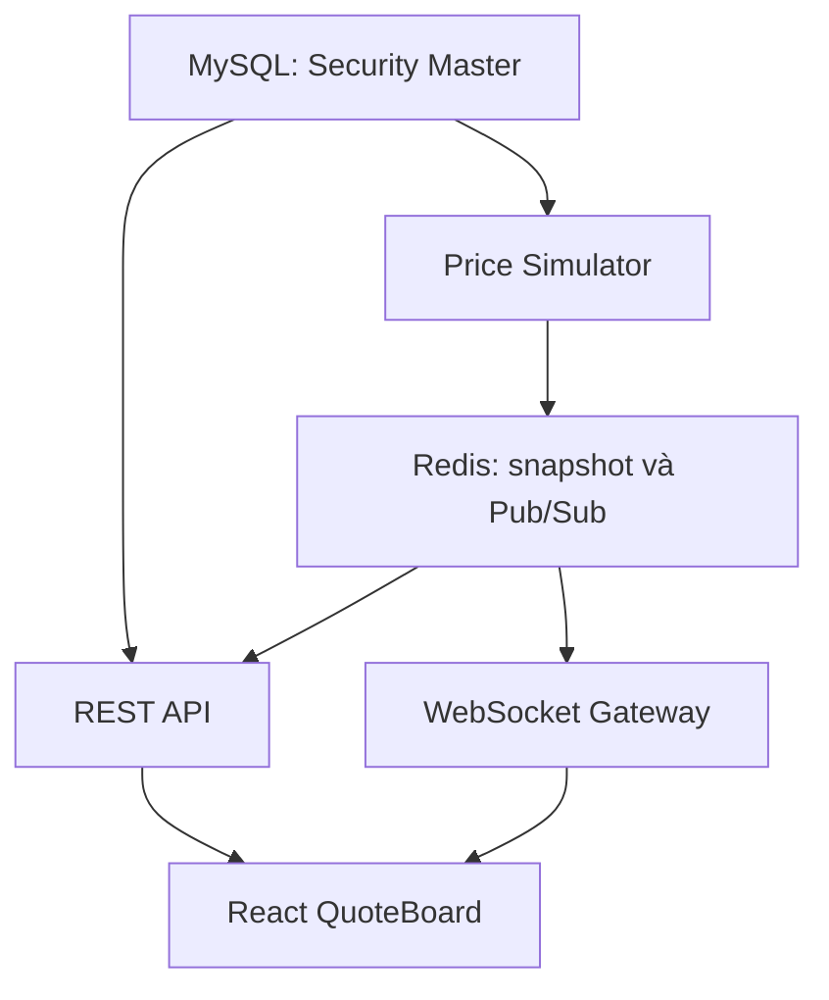

**Ngày 3 — Đọc bảng giá chứng khoán và xây Market Data realtime**

Hôm nay bạn dùng danh mục chứng khoán của ngày 2 để xây **bảng giá tự cập nhật trên React**, với luồng:

**Bộ sinh giá mô phỏng → Redis → WebSocket → React.**

MySQL tiếp tục quản lý Security Master. OpenCode là công cụ triển khai, dùng model bạn đã cấu hình.

---

**1. Mục tiêu và phân bổ thời gian**

| Thời gian | Nội dung | Kết quả |
|---|---|---|
| 30 phút nghiệp vụ | Đọc một dòng bảng giá | Hiểu giá, khối lượng và dư mua/bán |
| 30 phút kỹ thuật | Thiết kế snapshot, REST, Redis và WebSocket | Có hợp đồng dữ liệu thống nhất |
| 30–60 phút thực hành | Sinh giá, truyền dữ liệu và hiển thị React | Bảng giá cập nhật không cần reload |

**Phạm vi bắt buộc:** chạy realtime cho `sec-001 / SIMAAA / SIM_EQ_A`.

Các chứng khoán khác vẫn xuất hiện trong danh mục. Chưa có giá thì hiển thị `—`; chưa mô phỏng bảng giá trái phiếu.

---

**2. Nghiệp vụ — 30 phút**

**2.1. Một dòng bảng giá chứa thông tin gì?**

Bảng giá trực tuyến của HOSE có các nhóm thông tin như mã chứng khoán, trần, sàn, bên mua, khớp lệnh, bên bán, tổng khối lượng và giá cao/thấp. Bài học này triển khai một phần các trường đó. [rtboard.hsx.vn](https://rtboard.hsx.vn/?utm_source=chatgpt.com)

Ví dụ **hoàn toàn giả lập**, giá hiển thị theo đồng:

| Mã | Tham chiếu | Trần | Sàn | Mua tốt nhất | KL mua | Giá khớp | KL khớp gần nhất | Bán tốt nhất | KL bán |
|---|---:|---:|---:|---:|---:|---:|---:|---:|---:|
| SIMAAA | 25.000 | 27.000 | 23.000 | 25.000 | 500 | 25.100 | 100 | 25.200 | 300 |

Cách đọc:

- Giá tham chiếu của phiên giả lập là **25.000 đồng**.
- Lần khớp gần nhất có giá **25.100 đồng**, khối lượng **100 cổ phiếu**.
- Mức mua đang chờ tốt nhất là **25.000 đồng**, khối lượng **500 cổ phiếu**.
- Mức bán đang chờ tốt nhất là **25.200 đồng**, khối lượng **300 cổ phiếu**.

**Giá khớp gần nhất khác giá bạn chắc chắn sẽ mua được.** Giá chào và khối lượng có thể thay đổi trước khi lệnh được thực hiện.

**2.2. Hiểu từng nhóm giá**

| Trường | Ý nghĩa |
|---|---|
| `referencePrice` | Giá tham chiếu dùng để so sánh trong phiên |
| `ceilingPrice` | Giá cao nhất được phép trong cấu hình phiên |
| `floorPrice` | Giá thấp nhất được phép trong cấu hình phiên |
| `lastPrice` | Giá của lần khớp gần nhất |
| `openPrice` | Giá của lần khớp đầu tiên trong phiên |
| `highPrice` | Giá khớp cao nhất từ đầu phiên |
| `lowPrice` | Giá khớp thấp nhất từ đầu phiên |

Trong simulator hôm nay, **tham chiếu, trần và sàn được nhập sẵn**. Chưa tính theo quy định thực tế của từng thị trường, loại chứng khoán hoặc ngày đặc biệt.

**2.3. Giá mua và bán tốt nhất**

- Bên mua: mức giá cao nhất đang chờ được ưu tiên về giá.
- Bên bán: mức giá thấp nhất đang chờ được ưu tiên về giá.

Ví dụ:

| Phía | Mức 1 — tốt nhất | Mức 2 | Mức 3 |
|---|---:|---:|---:|
| Mua | 25.000 | 24.900 | 24.800 |
| Bán | 25.200 | 25.300 | 25.400 |

Ngày 3 chỉ cần hiển thị **một mức mua và một mức bán**. Ngày 5 sẽ xây sổ lệnh và cơ chế khớp.

**2.4. Phân biệt ba loại khối lượng**

| Trường | Ý nghĩa |
|---|---|
| `lastQuantity` | Khối lượng của lần khớp gần nhất |
| `totalVolume` | Tổng khối lượng đã khớp từ đầu phiên |
| `bidQuantity`, `askQuantity` | Khối lượng đang chờ tại mức giá mua/bán tương ứng |

Giả sử có ba lần khớp:

| Lần | Giá | Khối lượng |
|---|---:|---:|
| 1 | 25.000 | 100 |
| 2 | 25.100 | 200 |
| 3 | 25.200 | 100 |

Kết quả:

```text
lastPrice     = 25.200
lastQuantity  = 100
totalVolume   = 400

totalValue
= 25.000 × 100 + 25.100 × 200 + 25.200 × 100
= 10.040.000 đồng
```

Không tính tổng giá trị giao dịch bằng:

```text
lastPrice × totalVolume
```

vì các lần khớp có thể có giá khác nhau.

**2.5. Màu giá trong bảng demo**

Dùng quy ước hiển thị quen thuộc:

| Điều kiện | Màu |
|---|---|
| Bằng giá trần | Tím |
| Bằng giá sàn | Xanh lam |
| Cao hơn tham chiếu | Xanh lá |
| Thấp hơn tham chiếu | Đỏ |
| Bằng tham chiếu | Vàng |
| Chưa có dữ liệu | Trung tính, hiển thị `—` |

Khi viết hàm chọn màu, kiểm tra **trần và sàn trước**, rồi mới so sánh tăng/giảm.

Màu trên cho biết quan hệ với giá tham chiếu. Hiệu ứng nháy khi giá vừa thay đổi là một chức năng riêng.

---

**3. Kỹ thuật — 30 phút**

**3.1. Tách trách nhiệm dữ liệu**

| Thành phần | Dữ liệu hoặc trách nhiệm |
|---|---|
| MySQL / Security Master | ID, mã, tên, loại, thị trường, trạng thái |
| Price Simulator | Sinh dữ liệu thị trường giả lập |
| Redis | Lưu snapshot giá mới nhất và phân phối thông báo |
| Market Data API | Cung cấp snapshot qua REST |
| WebSocket Gateway | Gửi cập nhật đến trình duyệt |
| React | Ghép danh mục với giá theo `securityId` |

**Không ghi từng lần thay đổi giá vào bảng `securities`.**

Hôm nay cũng chưa cần lưu lịch sử tick trong MySQL. Nếu Redis bị xóa, simulator tạo lại dữ liệu của phiên mô phỏng.

**3.2. Kiến trúc demo**



Backend chạy **một bộ sinh giá**, độc lập với số tab trình duyệt.

Redis Pub/Sub không lưu lịch sử để phát lại; subscriber đang mất kết nối sẽ bỏ lỡ thông báo. Vì vậy, snapshot mới nhất phải được lưu trong Redis key, không chỉ phát qua channel. [Docs](https://redis.io/docs/latest/develop/use-cases/pub-sub/?utm_source=chatgpt.com)

**3.3. Dùng snapshot đầy đủ trong ngày 3**

Mỗi bản tin chứa **toàn bộ dữ liệu giá của một chứng khoán**.

Ví dụ TypeScript:

```ts
type PriceLevel = {
  price: number;
  quantity: number;
};

type QuoteSnapshot = {
  securityId: string;
  tradingDate: string;

  currency: "VND";
  priceUnit: "VND_PER_UNIT";

  referencePrice: number;
  ceilingPrice: number;
  floorPrice: number;

  lastPrice: number | null;
  lastQuantity: number;
  totalVolume: number;
  totalValue: number;

  openPrice: number | null;
  highPrice: number | null;
  lowPrice: number | null;

  bestBid: PriceLevel | null;
  bestAsk: PriceLevel | null;

  updatedAt: string;
  source: "SIMULATOR";
};
```

Quy ước:

- Giá dùng **đồng trên một đơn vị chứng khoán**; với cổ phiếu là đồng/cổ phiếu.
- Khối lượng là số đơn vị, không ngầm hiểu là số lô.
- `updatedAt` là thời điểm UTC, định dạng ISO 8601.
- `tradingDate` là ngày phiên mô phỏng, dạng `YYYY-MM-DD`.
- Chưa có lần khớp: `lastPrice`, `openPrice`, `highPrice`, `lowPrice` là `null`.
- Các giá trị số của demo phải nằm trong giới hạn số nguyên an toàn của JavaScript.

Snapshot đầy đủ giúp bạn tập trung vào nghiệp vụ và luồng realtime. **Delta, sequence và khôi phục khoảng trống dữ liệu sẽ học sâu ở ngày 17.**

**3.4. Cấu trúc Redis**

Đề xuất một key cho mỗi chứng khoán trong một ngày:

```text
md:quote:2026-10-20:sec-001
```

Giá trị: JSON của `QuoteSnapshot`.

Channel cập nhật:

```text
md:quotes
```

Luồng cập nhật:

1. Simulator tính snapshot mới.
2. Lưu snapshot vào Redis thành công.
3. Publish snapshot lên channel.
4. Gateway nhận thông báo và gửi cho client đã đăng ký.

Dùng connection riêng cho subscriber; không tạo subscriber mới cho mỗi trình duyệt.

Đây là luồng demo đơn giản. Ngày 3 chưa giải quyết đầy đủ lỗi tiến trình dừng giữa bước lưu và publish.

---

**4. Dữ liệu mô phỏng và quy tắc sinh giá**

**4.1. Cấu hình cho `sec-001`**

| Thuộc tính | Giá trị |
|---|---:|
| `securityId` | `sec-001` |
| Giá tham chiếu | 25.000 đồng |
| Giá trần giả lập | 27.000 đồng |
| Giá sàn giả lập | 23.000 đồng |
| Bước giá giả lập | 100 đồng |
| Chu kỳ sinh bản tin | 2 giây |

Các con số này là cấu hình học tập, **không đại diện cho quy tắc giao dịch của HOSE hoặc HNX**.

**4.2. Bắt đầu bằng chuỗi xác định**

Dùng ba lần khớp sau để dễ kiểm chứng:

```json
[
  { "price": 25000, "quantity": 100 },
  { "price": 25100, "quantity": 200 },
  { "price": 25200, "quantity": 100 }
]
```

Sau ba lần:

```json
{
  "lastPrice": 25200,
  "lastQuantity": 100,
  "totalVolume": 400,
  "totalValue": 10040000,
  "openPrice": 25000,
  "highPrice": 25200,
  "lowPrice": 25000
}
```

Khi chuỗi chạy đúng, có thể bổ sung giá ngẫu nhiên trong biên và đúng bước giá.

**4.3. Quy tắc cập nhật**

Với mỗi lần khớp mô phỏng:

```text
lastPrice     = giá mới
lastQuantity  = khối lượng mới

totalVolume   = tổng cũ + khối lượng mới
totalValue    = tổng cũ + giá mới × khối lượng mới

openPrice     = giá lần khớp đầu tiên
highPrice     = giá cao nhất đã xuất hiện
lowPrice      = giá thấp nhất đã xuất hiện
```

Dư mua và dư bán hôm nay có thể là dữ liệu giả được sinh riêng. Chúng **chưa được dựng từ sổ lệnh thật**.

Không phát các tick này sang OMS để ghi nhận tài sản: **tick thị trường không phải kết quả khớp lệnh của tài khoản**.

---

**5. REST API và WebSocket**

**5.1. REST — đọc giá mới nhất**

```http
GET /api/market-data/quotes?securityIds=sec-001,sec-003
```

Ví dụ response:

```json
{
  "data": [
    {
      "securityId": "sec-001",
      "tradingDate": "2026-10-20",
      "currency": "VND",
      "priceUnit": "VND_PER_UNIT",
      "referencePrice": 25000,
      "ceilingPrice": 27000,
      "floorPrice": 23000,
      "lastPrice": 25200,
      "lastQuantity": 100,
      "totalVolume": 400,
      "totalValue": 10040000,
      "openPrice": 25000,
      "highPrice": 25200,
      "lowPrice": 25000,
      "bestBid": {
        "price": 25100,
        "quantity": 500
      },
      "bestAsk": {
        "price": 25300,
        "quantity": 300
      },
      "updatedAt": "2026-10-20T07:00:06Z",
      "source": "SIMULATOR"
    }
  ],
  "missingQuoteSecurityIds": ["sec-003"]
}
```

Quy tắc:

| Tình huống | Kết quả |
|---|---|
| Chứng khoán tồn tại, có snapshot | Trả snapshot |
| Chứng khoán tồn tại, chưa có giá | Đưa vào `missingQuoteSecurityIds` |
| Có ID chứng khoán không tồn tại | HTTP 400, `INVALID_SECURITY_IDS` |
| Redis không truy cập được | HTTP 503, `MARKET_DATA_UNAVAILABLE` |
| Thiếu hoặc sai định dạng tham số | HTTP 400 |

Chưa có giá khác với giá bằng 0.

**5.2. WebSocket — đăng ký nhận giá**

Địa chỉ demo:

```text
ws://localhost:3000/ws/market-data
```

Client gửi:

```json
{
  "type": "subscribe",
  "securityIds": ["sec-001"]
}
```

Server gửi snapshot ban đầu và các cập nhật sau đó bằng cùng một cấu trúc:

```json
{
  "type": "quote.snapshot",
  "data": {
    "securityId": "sec-001",
    "...": "Toàn bộ các trường của QuoteSnapshot"
  }
}
```

Đoạn trên chỉ minh họa envelope; khi triển khai phải gửi object đầy đủ.

Luồng client hôm nay:

1. Lấy danh mục từ Security Master.
2. Mở WebSocket và đăng ký các ID cần xem.
3. Nhận snapshot ban đầu qua WebSocket.
4. Thay thế snapshot tương ứng mỗi khi nhận bản tin mới.
5. Khi mất kết nối, hiển thị `DISCONNECTED`.
6. Khi kết nối lại, đăng ký lại và nhận snapshot hiện tại.

REST được xây để tra cứu và kiểm chứng độc lập. Giao diện realtime hôm nay dùng snapshot ban đầu từ WebSocket để tránh việc một REST response đến muộn ghi đè giá mới.

Gateway cần xếp snapshot ban đầu và cập nhật tiếp theo theo thứ tự cho từng subscription. Trong demo một backend, có thể dùng hàng đợi xử lý nối tiếp; không chạy các lần xử lý bất đồng bộ chồng nhau.

---

**6. React: dựng bảng giá tối giản**

Cấu trúc đề xuất:

```text
src/
  components/
    QuoteBoard.tsx
    QuoteRow.tsx
    ConnectionStatus.tsx
  hooks/
    useMarketData.ts
  types/
    market-data.ts
```

Lưu dữ liệu theo ID:

```ts
type QuotesById = Record<string, QuoteSnapshot>;
```

Khi nhận bản tin:

```ts
setQuotesById((previous) => ({
  ...previous,
  [quote.securityId]: quote
}));
```

Không ghép dữ liệu chỉ bằng `symbol`: ngày 2 đã có hai bản ghi `SIMAAA` trên hai thị trường.

**Các cột bắt buộc:**

| Cột | Nguồn |
|---|---|
| Mã và thị trường | Security Master |
| Trạng thái chứng khoán | Security Master |
| Tham chiếu, trần, sàn | Quote |
| Mua tốt nhất, KL mua | Quote |
| Giá khớp, KL khớp gần nhất | Quote |
| Bán tốt nhất, KL bán | Quote |
| Tổng khối lượng | Quote |
| Cập nhật lúc | Quote |

**Hàm màu giá:**

```ts
function getPriceColor(
  price: number | null,
  reference: number,
  ceiling: number,
  floor: number
): string {
  if (price === null) return "neutral";
  if (price === ceiling) return "ceiling";
  if (price === floor) return "floor";
  if (price > reference) return "up";
  if (price < reference) return "down";
  return "reference";
}
```

Giữ giá trị gốc là số và chỉ format khi render:

```ts
const formatNumber = new Intl.NumberFormat("vi-VN");

formatNumber.format(25200); // "25.200"
```

Trong `useEffect`, cần đóng WebSocket và dọn listener khi cleanup. React có thể chạy lại chu kỳ setup/cleanup trong quá trình phát triển; cleanup đúng giúp tránh kết nối và listener bị nhân đôi. [React](https://react.dev/learn/synchronizing-with-effects?utm_source=chatgpt.com)

---

**7. Thực hành — 30–60 phút**

| Thời gian | Công việc |
|---|---|
| 10 phút | Kết nối Redis, tạo snapshot ban đầu và bộ sinh giá |
| 10–15 phút | Xây REST API và WebSocket subscription |
| 10–20 phút | Dựng bảng React và màu giá |
| 10–15 phút mở rộng | Kiểm tra nhiều tab, ngắt kết nối và debug |

Nếu thời gian hạn chế, chỉ làm một dòng realtime cho `sec-001`.

**Các kiểm tra cần làm:**

1. Chạy ba tick xác định và đối chiếu tổng khối lượng, tổng giá trị.
2. Gọi REST và kiểm tra snapshot mới nhất.
3. Mở React, xác nhận giá đổi mà không reload.
4. Mở thêm tab, xác nhận tốc độ sinh tick không tăng.
5. Đóng WebSocket, xác nhận UI báo mất kết nối.
6. Xác nhận `sec-005` không nhận nhầm giá của `sec-001`.
7. Xác nhận `sec-002` vẫn xuất hiện với trạng thái `SUSPENDED`, dù chưa có giá.

---

**8. Tình huống debug**

**A. Giá hiển thị sai 1.000 lần**

Backend gửi:

```json
{ "lastPrice": 25200 }
```

Frontend lại xử lý:

```ts
const displayPrice = quote.lastPrice * 1000;
```

Kết quả sai: **25.200.000 đồng**.

Cách điều tra:

- Xem payload gốc trong Network.
- Kiểm tra `priceUnit`.
- Tìm phép nhân hoặc chia 1.000 trong formatter.
- Thống nhất API dùng đồng; UI chỉ format số.

**B. Mở hai tab làm giá chạy nhanh gấp đôi**

Nguyên nhân thường gặp:

```text
Mỗi WebSocket connection → tạo một setInterval sinh giá
```

Cách sửa:

```text
Backend khởi động → một bộ sinh giá
Mỗi client kết nối → chỉ đăng ký nhận dữ liệu
```

**C. Tổng khối lượng tăng dù không có tick mới**

Ví dụ lỗi:

```ts
setTotalVolume((previous) => previous + quote.totalVolume);
```

`totalVolume` trong snapshot đã là tổng tích lũy. Client phải thay thế bằng giá trị mới, không cộng tiếp.

Đây là khác biệt giữa **snapshot trạng thái** và **sự kiện phát sinh thêm**.

---

**9. Prompt cho OpenCode**

```text
Tôi đang học ngày 3 của Securities Trading Simulator:
Market Data và bảng giá realtime.

Môi trường:
- Node.js + TypeScript, MySQL, React + TypeScript.
- Redis.
- OpenCode; model tôi cấu hình GPT 5.6 Terra, High.
- Modular monolith.
- Giữ cấu trúc hiện tại từ ngày 1 và ngày 2.

Trước khi code:
1. Đọc Security Master, kết nối MySQL và các API hiện có.
2. Kiểm tra project đã có Redis/WebSocket/frontend chưa.
3. Tóm tắt luồng sẽ triển khai.
4. Chọn phạm vi tối thiểu cho 30–60 phút thực hành.

Mục tiêu:
Hiển thị giá realtime cho sec-001 trên React.
Các chứng khoán khác vẫn xuất hiện từ Security Master,
chưa có giá thì hiển thị dấu —.

Dữ liệu giả lập:
- sec-001 / SIMAAA / SIM_EQ_A.
- Reference 25000, ceiling 27000, floor 23000.
- Bước giá giả lập 100 đồng.
- Tick mỗi 2 giây.
- Chạy ba tick đầu:
  25000 × 100
  25100 × 200
  25200 × 100.
- Sau ba tick:
  lastPrice=25200, lastQuantity=100,
  totalVolume=400, totalValue=10040000,
  openPrice=25000, highPrice=25200, lowPrice=25000.
- Sau đó có thể tiếp tục bằng chuỗi xác định hoặc giá ngẫu nhiên
  trong biên và đúng bước giá.
- Bộ sinh chỉ chạy một lần trong backend, không chạy theo số client.
- Đây là tick thị trường giả, không tạo execution cho tài khoản.

Triển khai:
1. Tạo module Market Data.
2. Dùng QuoteSnapshot đầy đủ theo bài học.
3. Lưu snapshot JSON vào:
   md:quote:<tradingDate>:<securityId>.
4. Sau khi lưu thành công, publish qua channel md:quotes.
5. Dùng connection riêng cho Redis subscriber.
6. Xây GET /api/market-data/quotes?securityIds=...
   - Validate ID qua Security Master.
   - ID không tồn tại: 400 INVALID_SECURITY_IDS.
   - Có chứng khoán nhưng chưa có giá:
     missingQuoteSecurityIds.
   - Redis lỗi: 503 MARKET_DATA_UNAVAILABLE.
7. Xây WebSocket /ws/market-data:
   - Nhận subscribe với securityIds.
   - Gửi snapshot ban đầu và các snapshot cập nhật.
   - Chỉ gửi các ID client đã đăng ký.
   - Giữ thứ tự snapshot ban đầu và cập nhật cho từng subscription.
   - Dọn subscription khi client ngắt kết nối.
8. React:
   - Đọc danh mục từ API ngày 2.
   - Nhận snapshot ban đầu và cập nhật qua WebSocket.
   - Lưu quote theo securityId.
   - Thay thế snapshot, không cộng dồn totalVolume.
   - Hiển thị trạng thái kết nối.
   - Reconnect thì đăng ký lại và lấy snapshot hiện tại.
   - Cleanup WebSocket/listener trong useEffect.
   - Format giá theo vi-VN, đơn vị đồng.
   - Tô màu trần/sàn/tham chiếu/tăng/giảm.

Giới hạn:
- Chạy demo một backend instance.
- Không lưu lịch sử từng tick trong MySQL.
- Không ghi giá vào bảng securities.
- Chưa triển khai delta, replay hoặc giao thức sequence.
- Không dựng matching engine hôm nay.
- Chưa mô phỏng bảng giá trái phiếu.
- Không coi giá bảng điện là kết quả khớp của tài khoản.
- Không nhân hoặc chia giá cho 1000 nếu chưa có quy ước rõ ràng.

Xác minh:
- Ba tick cho kết quả nghiệp vụ chính xác.
- REST đọc được snapshot từ Redis.
- React cập nhật không reload.
- Hai tab không làm tăng tốc độ sinh tick.
- Mất kết nối được phản ánh trên UI.
- sec-005 không nhận nhầm giá của sec-001 dù cùng symbol.
- API Security Master và health cũ vẫn hoạt động.

Sau khi làm:
- Chạy kiểm tra phù hợp và nêu kết quả thực tế.
- Cập nhật README với cách chạy Redis, backend, frontend.
- Giải thích đường đi của một tick.
- Nêu rõ các giới hạn phục hồi chưa giải quyết.
```

**Ngày 3 hoàn thành khi:**

- [ ] Bạn đọc được một dòng bảng giá và phân biệt khớp lệnh với dư mua/bán.
- [ ] Tổng khối lượng và tổng giá trị được tính đúng.
- [ ] Redis lưu được snapshot mới nhất.
- [ ] REST và WebSocket dùng cùng quy ước dữ liệu.
- [ ] React cập nhật giá mà không reload.
- [ ] Nhiều tab không làm bộ sinh giá chạy nhiều lần.
- [ ] Giá gắn đúng `securityId` và không sai đơn vị.

Ngày 4 sẽ bổ sung **phiên giao dịch và quy tắc nhận lệnh**, để hệ thống bắt đầu trả lời: “Với chứng khoán này, ở thời điểm này, loại lệnh nào được chấp nhận?”.